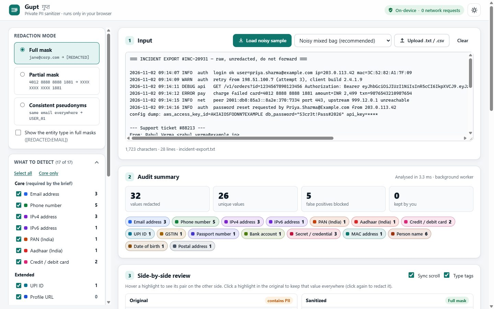
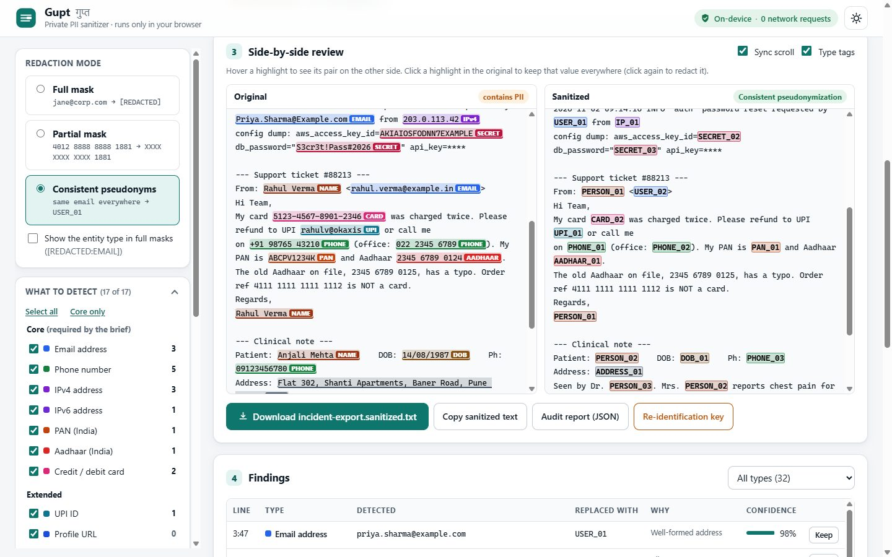
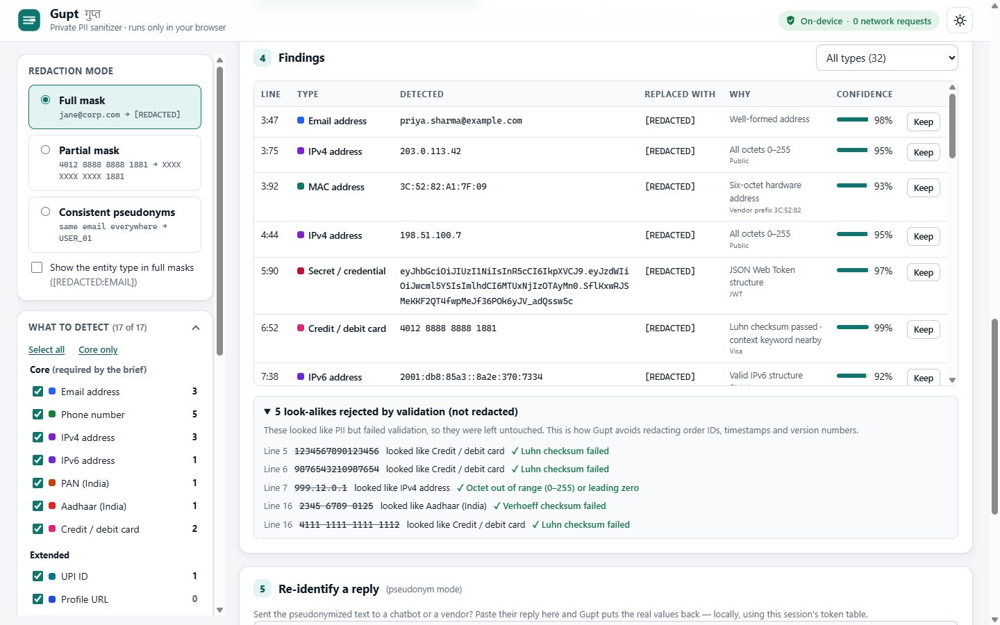
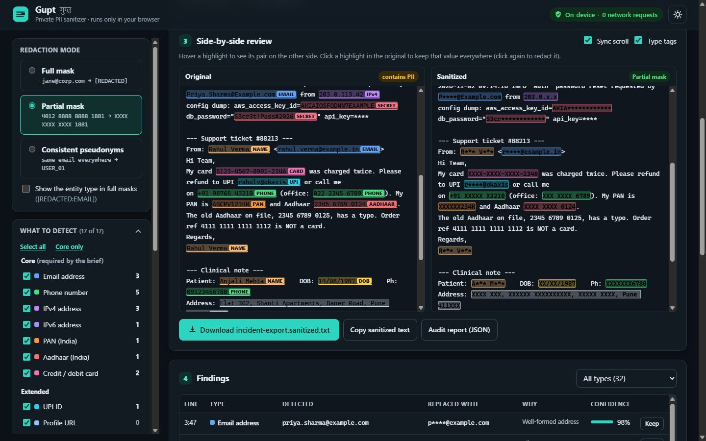
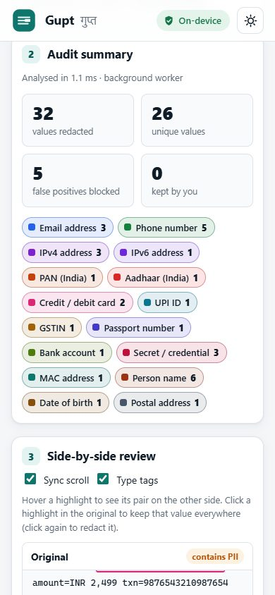

# Gupt (गुप्त): private PII sanitizer

[](https://github.com/prajapatipratik547-ui/gupt-pii-sanitizer/actions/workflows/ci.yml)


**Paste text or drop a `.txt` / `.csv` file. Gupt finds the personal data in it, classifies it and redacts it without the text ever leaving your browser.**

### ▶ Live demo: **https://prajapatipratik547-ui.github.io/gupt-pii-sanitizer/**

Built for **PromptWars × NIAT (GDG)**, Cybersecurity & Data Privacy track, in **Google Antigravity** with Claude Code as the coding agent. Every prompt is recorded in [`PROMPT_LOG.md`](PROMPT_LOG.md).

> *Gupt* is Hindi for "hidden" or "secret".



## Try it in 60 seconds

1. Open the [live demo](https://prajapatipratik547-ui.github.io/gupt-pii-sanitizer/) and click **Load noisy sample**. 32 values are redacted across 17 types, and **5 look-alikes are blocked**.
2. Scroll to **Side-by-side review**. Hover any highlight to see its pair on the other side.
3. Switch to **Partial mask** (`XXXX-XXXX-XXXX-2346`), then **Consistent pseudonyms**. `priya.sharma@…` and `Priya.Sharma@Example.com` both become `USER_01`.
4. Open **Findings → 5 look-alikes rejected**. `1234567890123456` was skipped because its *Luhn checksum failed*, and `2345 6789 0125` because its *Verhoeff checksum failed*.
5. Click **Download incident-export.sanitized.txt**.
6. Bonus: pick **False-positive torture test** from the sample menu. Only 1 of 16 suspicious-looking values is real, and Gupt finds exactly that one.

| Pseudonymized diff | Every rejected look-alike, with its reason |
| --- | --- |
|  |  |
|  |  |

---

## The problem

Teams paste server logs into chatbots, forward resumes to vendors, attach support tickets to bug reports and share clinical notes for review. Those texts are full of emails, phone numbers, IPs, PAN and Aadhaar numbers and card numbers. Most "redaction" tools upload the text to a server to clean it, so the data is exposed while you are trying to protect it.

## The solution

Gupt is a static web app. All detection, redaction and export runs in the tab, and the page's Content-Security-Policy sets `connect-src 'none'`, so **the browser refuses any network request from the page**. A compromised dependency could not send your text anywhere, and Gupt has no runtime dependencies anyway. Once the page has loaded you can go offline and it keeps working.

## Requirement coverage

| Brief requirement | How Gupt meets it |
| --- | --- |
| **Paste raw text or upload .txt/.csv** | Paste box, file picker and drag-and-drop. Also reads `.log`, `.tsv` and `.md`. Handles UTF-8, UTF-16 and BOMs, refuses binary files, 10 MB limit. |
| **Client-side only** | Zero runtime dependencies. CSP `connect-src 'none'`, `default-src 'none'`, `form-action 'none'`. A live counter shows network requests made (always 0). ESLint bans `fetch`, `XMLHttpRequest` and `WebSocket` in app code. |
| **1. Detect emails, phones, IPs, PAN, Aadhaar, cards** | Emails, including URL-encoded ones in logs (`a%40b.com`). Indian mobiles (+91 / 0 / bare), landlines with STD code, international E.164. IPv4 and IPv6 (compressed and IPv4-embedded). PAN. Aadhaar (spaced, hyphenated, compact). Cards from every major network, including RuPay. |
| **…and highlight them** | Colour-coded highlights with a text type tag, so colour is never the only cue. Hovering a highlight outlines its pair in the other pane. |
| **2. Luhn validation for cards** | Luhn checksum plus a check of the issuer prefix and length (Visa, Mastercard incl. 2-series, RuPay, Amex, Discover, Diners, JCB, UnionPay, Maestro). Random 16-digit order IDs, timestamps and `0000…` placeholders are rejected, and the reason is shown. |
| **Extra validation (beyond the brief)** | **Verhoeff** checksum for Aadhaar (the algorithm UIDAI uses). PAN holder-type letter. GSTIN mod-36 check character. IPv4 octet ranges. Structural IPv6 parsing. Version strings like `build 2.4.1.9` are not treated as IPs. |
| **3a. Full mask** | `[REDACTED]`, or optionally `[REDACTED:EMAIL]` |
| **3b. Partial mask** | Per-type: `XXXX-XXXX-XXXX-1881` (keeps your separators), `p****@example.com`, `+91 XXXXX X3210`, `XXXX XXXX 0124`, `203.0.x.x`, MAC vendor prefix kept, DOB year kept… |
| **3c. Consistent pseudonymization** | `USER_01`, `PHONE_01`, `CARD_01`… Values are normalised first, so `Priya@Example.com` = `priya@example.com`, `+91 98765 43210` = `098765 43210`, and `4012 8888…` = `4012-8888-…` all map to the same placeholder. |
| **4. Live side-by-side diff** | The original (highlighted) and the sanitized output, updated as you type. Synced scrolling, hover-linked pairs. |
| **…with entity detection counts** | Totals, unique values, false positives blocked, kept values, per-type chips and per-type counts beside every toggle. |
| **…1-click download** | Downloads `<name>.sanitized.<ext>`, keeping the original extension and the CSV structure. |
| **Deliverable: 1-click noisy sample loader** | **Load noisy sample** button plus 6 samples: mixed incident export, server logs, resume, clinical note, customer CSV, and a false-positive torture test. |
| **Deliverable: prompt log** | [`PROMPT_LOG.md`](PROMPT_LOG.md) |

## Features beyond the brief

- **"False positives blocked" panel.** Every look-alike that failed validation is listed with the reason it was skipped, for example `1234567890123456: Luhn checksum failed`.
- **Strict / relaxed validation toggle.** Relaxed mode also flags numbers that have the right shape but fail their checksum, at lower confidence.
- **11 extra entity types:** UPI IDs, profile URLs (LinkedIn, GitHub, X…), GSTIN, passport numbers, bank accounts, secrets (AWS, GitHub, Stripe and Google keys, JWTs, bearer tokens, `password=`), MAC addresses, person names, dates of birth, postal addresses, and your own custom terms.
- **Name tracking.** "Patient: Anjali Mehta" is detected from its label. Later mentions such as "Mrs. Mehta" are then linked to the **same** pseudonym. If a surname belongs to two different people, Gupt does not guess.
- **Column-aware CSV.** A `full_name`, `dob` or `address` column is redacted cell by cell, quoting is preserved, and placeholder rows like "Test User" are skipped.
- **Keep a value.** Click any highlight, or use the Keep button in the findings table, to leave that value un-redacted everywhere in the document.
- **Re-identify a reply.** Send pseudonymized text to an LLM, paste its answer back, and Gupt restores the real values locally.
- **Audit report (JSON)** with types, line and column, confidence, the check that passed and the replacement written. It contains **no original values**, and a test enforces that.
- **Re-identification key** download. It asks for a second click to confirm because the file contains real PII.
- **Session activity log** that records actions only, never data.
- **Findings table** with line:column, the reason for each detection, a confidence bar and a type filter.
- Dark and light themes, a responsive layout, a print stylesheet, and only preferences are remembered (never the text you sanitize).

## How detection works

```
text ──► 30 detectors (regex anchored at token boundaries)
            │
            ├─ context rules: "passport" required nearby · "version 1.2.3.4" rejected · "Aadhaar" boosts confidence
            ├─ validators: Luhn + IIN · Verhoeff · PAN holder type · GSTIN mod-36 · IPv4 range · IPv6 parse
            │     └─ failures ──► "false positives blocked" list (with reason)
            ├─ CSV column rules (header → type)
            ├─ resume-header heuristic · name propagation · custom terms
            ▼
       overlap resolution (priority › length › confidence, O(n) occupancy bitmap)
            ▼
       normalise → key → full mask │ partial mask │ pseudonym table
            ▼
       output + replacement spans ──► diff view · findings · audit report · download
```

Every pattern starts with a negative look-behind, so it can only begin at a token boundary. This keeps scanning linear even on a 2 MB line with no spaces, and a test checks it.

## Security model

See [`SECURITY.md`](SECURITY.md) for the full policy and how to verify each guarantee yourself.

| Threat | Mitigation |
| --- | --- |
| Data leaves the device | No backend. CSP `connect-src 'none'` blocks fetch, XHR, WebSocket and beacons. `form-action 'none'`. Live request counter. |
| XSS from pasted content | User text only ever reaches the DOM through text nodes and `textContent`. ESLint bans `innerHTML`, `outerHTML` and `insertAdjacentHTML`. CSP allows no inline scripts and enforces **Trusted Types**, so the browser itself rejects HTML or script injection. |
| Network code in the bundle | Vite's preload polyfill (the only `fetch` call) is disabled. An end-to-end test confirms the shipped JavaScript contains no `fetch`, XHR or beacon. |
| Clickjacking | Static hosting can't send `frame-ancestors`, so the app refuses to start inside another site's frame. |
| Supply-chain compromise | Zero runtime dependencies. Dev tooling is not shipped. |
| Data left behind | Nothing is written to `localStorage` except preferences. Blob URLs are revoked right after download. |
| Audit report leaks PII | The report is built from types and positions only. A unit test asserts that no detected value appears in it. |
| Re-identification key mishandled | Only offered in pseudonym mode, needs two clicks to download, and carries an in-file warning. |
| ReDoS | Boundary-anchored patterns with bounded repetition. A regression test runs **all 30 detectors against 22 adversarial 100 KB inputs**. It caught (and now prevents) a quadratic credential pattern. |
| Main-thread freeze on big files | Analysis runs in a Web Worker, with an automatic main-thread fallback. The preview is capped at 200k characters while the export always covers the whole file. |

## Accessibility

- Semantic landmarks, a skip link, one `h2` per step, and every control labelled. A test checks the labelling.
- **axe-core runs in the test suite** on the empty and loaded states and reports zero violations.
- Colour is never the only signal: highlights carry text tags, and modes and badges have text labels.
- Keyboard: every action is a real button or input, the findings table is a keyboard alternative to clicking highlights, and focus rings are visible.
- `aria-live` announces the summary; toasts use `role="status"`. No blocking dialogs.
- `prefers-reduced-motion` and `prefers-color-scheme` are respected, and the layout works at 390 px wide with no horizontal scroll.

## Testing

```bash
npm test            # 229 unit + integration tests (Vitest, node + jsdom, axe-core, ReDoS guard)
npm run coverage    # whole app: ~97% lines, ~95% statements, ~89% branches (thresholds enforced)
npm run check       # typecheck + lint + test + build
npm run e2e         # 41 end-to-end checks in real headless Chrome (needs `npm run preview -- --port 4317`)
```

The UI tests load the real `index.html` in jsdom and click through each flow: sample loading, typing, upload, binary-file refusal, every mode, keep and unkeep, filters, custom terms, all four downloads, clipboard fallback, restore and theme. Module tests cover the Web Worker client, including its crash fallback to the main thread, plus scroll sync and the privacy monitor.

The **end-to-end suite** ([`scripts/e2e.mjs`](scripts/e2e.mjs)) drives the production build in headless Chrome over the DevTools protocol, with no test framework or extra dependency. CI runs it on every push. It checks:

- the CSP is present, **Trusted Types is enforced**, and there are zero requests to other origins;
- real file downloads contain no original values;
- the audit report is PII-free;
- an XSS payload is shown as text and never executed;
- CSV and binary-file uploads behave correctly;
- every sample loads;
- **2 MB of text is processed in ~130 ms**;
- the app keeps working with the network switched **offline**;
- keyboard navigation starts at the skip link;
- there are zero console errors.

### Scores

| Check | Result |
| --- | --- |
| Lighthouse (mobile and desktop) | Performance **100** · Accessibility **100** · Best Practices **100** |
| axe-core | 0 violations (empty and loaded states) |
| `npm audit` | 0 vulnerabilities |
| Bundle | ~100 KB total, 0 runtime dependencies |
| Noisy sample (1.7 KB) | ~3 ms in a Web Worker |
| 2 MB log | ~130 ms |

Lighthouse SEO scores 91 because its in-page `robots.txt` fetch is blocked by our own `connect-src 'none'`. That is the privacy guarantee doing its job.

## Run locally

```bash
npm install
npm run dev         # http://localhost:5173
npm run build       # static site in dist/ (CSP is injected at build time)
npm run preview
```

Requires Node 20+. The production build is about 100 KB in total and needs no server-side code. Host `dist/` anywhere static.

**Deploying with GitHub Pages:** in the repository go to *Settings → Pages → Source → GitHub Actions*. The included workflow tests, builds and deploys on every push to `main`. No extra branch is created, so the repository keeps a single branch as the rules require.

## Project structure

```
src/
  core/                 pure, framework-free engine (runs in the worker and in tests)
    entities.ts         registry of 18 entity types: label, priority, pseudonym prefix
    validators.ts       Luhn, IIN brands, Verhoeff, PAN, GSTIN, IPv4/IPv6
    detectors.ts        30 boundary-anchored detectors with context rules
    engine.ts           detection, CSV columns, name propagation, overlap resolution
    normalize.ts        canonical keys for consistent pseudonyms
    redact.ts           full / partial / pseudonym modes, re-identification
    csv.ts              offset-preserving RFC 4180 parser, header rules
    pipeline.ts         analyze(): detect + redact + counts + timing
    report.ts           PII-free audit report, key file, file names
    samples.ts          6 synthetic noisy samples
  ui/                   DOM layer (no framework): app, render, diff, exports, privacy monitor, theme
  worker.ts             Web Worker entry
tests/                  Vitest (node + jsdom), axe-core
scripts/e2e.mjs         end-to-end checks in headless Chrome over the DevTools protocol
docs/screenshots/       images used in this README
```

## Honest limitations

- Name and address detection relies on cues (titles, labels, CSV headers, greetings and sign-offs, a resume's header line) rather than a machine-learning NER model. A bare name in free prose with no cue is not caught; you can add it under **Always redact**.
- Phone detection is tuned for Indian formats plus E.164. Some unusual national formats may be missed.
- All sample data is synthetic. Aadhaar and card numbers are generated or published test values that pass their checksums.

## License

MIT
